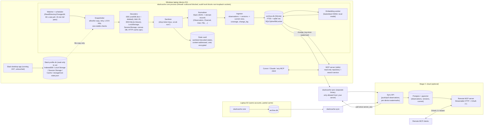

# slack-cache-mcp: offline-only Slack desktop cache archive and MCP server (implementation plan)

Version 1.0, 2026-11-18. Author: Grok Bot for Maxim Salnikov.
Status: ready for implementation. Milestone M0+M1 kickoff prompt is in `KICKOFF_PROMPT.md`.

> Hard invariant, repeated everywhere: **this system never contacts Slack servers.** It reads only files the
> official Slack desktop app has already written to the local disk. It never reads or stores tokens or cookies,
> never calls any Slack API (official, edge, or hosted MCP), never launches, drives, injects into, or scrolls the
> Slack app, and never writes into the Slack profile directory.

---

## 0. TL;DR of the decisions

| Topic | Decision |
|---|---|
| Base repo | **Do not fork slacrawl as the codebase.** Start a new, small, Python repo `slack-cache-mcp` that ports slacrawl's desktop heuristics (MIT, attributed), reuses the decoder already proven on Maxim's real Microsoft Store cache (`reference/slack_cache_probe.py`, built on MIT `ccl_chromium_reader`), borrows slack-archive-mcp's observation/preferred-version model and tool shapes (MIT), and writes Slack-export-format output for interoperability with slackdump (AGPL, so format compatibility only, no code), slack-archive-mcp and slacrawl's importer. Contribute the Windows path fix upstream to slacrawl (open issue #299) as a separate, small PR. Rationale in section 2. |
| Language / stack | Python 3.12 (uv), `ccl_chromium_reader` (vendored, pinned), SQLite (FTS5 + sqlite-vec), local ONNX embeddings (fastembed), official MCP Python SDK v2 (`MCPServer`), stdio now, Streamable HTTP + OAuth 2.1 later. |
| Capture strategy | Continuous, change-driven snapshotting (file watcher + 60 s stat poll + 15 min full pass) into an **append-only, never-delete** archive. Every distinct decoded Redux state is kept (sanitized, content-addressed) so states that Slack later overwrites are not lost. Every local source is mined (section 4). |
| Archive model | Observations (immutable sightings, with device + source provenance) -> versions (distinct content per message) -> current view (deterministic projection). Absence from the cache is **never** treated as deletion. |
| Search | Hybrid: FTS5/BM25 (unicode61 + trigram) + local multilingual embeddings in sqlite-vec, fused with RRF, Slack-style query operators, thread-aware grouping and context expansion. |
| Multi-laptop | Each laptop is a device with its own ID and keys. Sync ships **observations** (a grow-only set, so merge is commutative, associative and idempotent) through an append-only change log with per-device watermarks; the current view is recomputed deterministically, so all replicas converge. Stage 1 can exchange encrypted bundles through a folder; stage 2 pushes to a cloud Postgres+pgvector behind an OAuth 2.1 protected MCP endpoint. |
| Storage abstraction | `ArchiveRepository` protocol; `SqliteRepository` now, `PostgresRepository` (pgvector) in stage 2. MCP tools only talk to the repository and the search service. |
| Enforcement of offline rule | Package boundary (`desktop/` + `store/` + `search/` + `mcp_server/` may not import network clients: import-linter contract + AST test), runtime audit hook that blocks non-loopback sockets in the core process, pytest-socket in tests, allowlist-only snapshot paths, token/secret scrubber with a "no `xox` in DB" test, Windows Firewall outbound block rule on the core binary, project `.cursor/cli.json` deny rules so the coding agent itself cannot read the live Slack profile. |

---

## 1. Goals, non-goals, constraints

### Goals
1. Capture as much Slack content as possible (guest channels in several workspaces, DMs, threads, files metadata, canvases, saved items) **purely from local files** written by the Slack desktop app, which runs 24/7 on Windows.
2. Accumulate history beyond Slack's sliding cache window: first_seen/last_seen, edit history, deletion detection.
3. Expose it through an MCP server with intelligent search (hybrid lexical + semantic, filters, thread-aware context, name resolution, coverage/status).
4. Be ready for several laptops (each with a partial cache) and for a cloud-hosted, authenticated MCP-enabled database in stage 2.

### Non-goals
- Fetching anything Slack has not already put on disk: no history backfill, no file downloads from files.slack.com, no avatar fetches, no search API.
- Automating the Slack UI (scrolling, clicking, opening channels, keyboard macros, CDP, remote debugging, injected JS). Coverage is grown by Maxim's normal use only (section 17).
- Writing to Slack (no posting, reactions, marking read).

### Constraints
- Windows first: Microsoft Store Slack at `%LocalAppData%\Packages\91750D7E.Slack_8she8kybcnzg4\LocalCache\Roaming\Slack` (verified on Maxim's PC), direct install at `%AppData%\Slack`, plus macOS (`~/Library/Application Support/Slack`, `~/Library/Containers/com.tinyspeck.slackmacgap/Data/Library/Application Support/Slack`) and Linux (`$XDG_CONFIG_HOME/Slack`, `~/.config/Slack`, Flatpak `~/.var/app/com.slack.Slack/config/Slack`, Snap `~/snap/slack/current/.config/Slack`).
- No admin rights required for normal operation.
- No real Slack data in the repository, tests, fixtures, logs committed, or issue reports.

---

## 2. Repository evaluation and decision

All five repos were read at the commits listed. Upstream stats fetched 2026-11-18 from the GitHub API.

| Repo | License / activity | What it really is (cited) | Server contact | Verdict |
|---|---|---|---|---|
| **openclaw/slacrawl** @a8cb800 | MIT; 238 stars, 29 forks, pushed 2026-11-18, ~47 commits in the last 30 days; Go 1.27, ~32k LOC non-test | Multi-source Slack archiver: API (`internal/slackapi/*`, slack-go), Slack hosted MCP client (`internal/slackmcp/*`, `internal/mcpclient/*`), git snapshot sharing (`internal/share/*`), remote delivery (`internal/remotedelivery/*`), release check via crawlkit (`internal/cli/releasecheck.go`, runs before command dispatch per docs), and a **desktop source** (`internal/slackdesktop/*`). Desktop: `snapshot.go` `SnapshotPath` copies `storage/root-state.json`, `local-settings.json`, `Local Storage/leveldb`, `IndexedDB/https_app.slack.com_0.indexeddb.leveldb` + `.blob` to a temp dir with `os.Root.ReadFile` and **aborts on the first read error** (no retry, no LOCK skip); `redux.go` `scanReduxBlobRefs` + `analyzeReduxBlob`/`locateInnerV8Payload` handle `ff 11 02` + Snappy + Blink + V8 v15/v16, then `runReduxDecoder` shells out to **Node** (`exec.CommandContext(ctx, "node", "-e", reduxDecoderScript, ...)`) running `redux_decoder.js`, which extracts only `channels`, `members`, `messages`, `threads`. `localstorage.go` reads drafts, recent channels, read markers, statuses, and unmarshals `localConfig_v2` into `DesktopTeam` which has a `Token` field (`models.go:146`; only redacted on output, `desktop.go:73`). `admission.go`/`filter.go` implement DM exclusion and retention floors. Store schema `internal/store/schema.go` v9: `messages` PK `(channel_id, ts)`, `source_rank`/`source_name`, `message_events`, `message_event_heads` trigger for edit/delete history, FTS5 `message_fts`, an unused `embedding_jobs` table. Windows path detection missing (`internal/config/config.go:568` `desktopPathCandidates` has darwin/linux only; open issue **#299**, maintainers have not decided on Windows support; no Windows CI or release archives). **No MCP server**, no semantic search. | Desktop mode: none. The same binary contains API, hosted-MCP, git-push and release-check code paths. `internal/slackdesktop/redux.go` and `internal/search/normalize.go` import `github.com/slack-go/slack` (an API client library, used for types). | **Do not fork as the base.** Port its desktop heuristics; contribute Windows detection upstream. |
| itsryanarmani/slackclaw @69cb9c6 | MIT; 0 stars; pushed 2026-11-04; TypeScript | Blob-dir-only cache reader (`src/sources/cache/{locate,dump,parse,sync}.ts`), Node `v8.deserialize`, SQLite FTS5 (`src/store/schema.sql`: workspaces, channels, users, messages, attachments, mentions, saved_items, sync_state). Windows path built from `process.env.HOME` (`src/config/paths.ts`), which is normally unset on Windows; no Store path; skips inline IDB values. MCP only on the roadmap. | None in current code. | Reference only (its `saved_items` table is a useful reminder). |
| bioshazard/slack-archive-mcp @d5b0ad0 | MIT; 0 stars; pushed 2026-11-01; Bun/TS, ~3k LOC, hexagonal (`src/ports/*`, `src/adapters/*`) | Offline MCP over **official Slack exports** materialized into SQLite. Schema (`src/adapters/sqlite/schema.ts`): `source_files`, **`observations`** (every sighting, payload sha256, version_order) and **`messages`** = preferred observation selected by a window function in `materialize()`; FTS5 external-content table. Tools (`src/mcp.ts`): `archive_status`, `list_channels`, `search` (modes all/any/phrase/exact, author/channel/after/before, sort), `get_message` (with `versions=true`), `get_thread`, `get_context`. Streamable HTTP adapter with constant-time bearer check, Host/Origin allowlists, 64 KB body cap (`src/adapters/mcp/http.ts`). | None (README shows `docker run --network none`). | **Borrow** the observation -> preferred-version model, tool semantics (exact mode, versions, context), and the HTTP hardening checklist. Can consume our Slack-export output as a second server. |
| rusq/slackdump @fec2e68 | **AGPL-3.0**; 2.9k stars; pushed 2026-11-14; Go | API + Edge API dumper; auth via browser automation or cookie->token exchange (`auth/*`, `internal/edge/edge.go`). `slackdump mcp` (`internal/mcp/tools.go`: load_source, list_channels, get_channel, list_users, get_messages, get_thread, get_workspace_info, command_help) is offline and reads any `source.Load()` format (`source/source.go`: chunk dir, export ZIP/dir, dump, SQLite). No full-text search. | Yes (all dumping). | **Format compatibility only.** AGPL: do not copy code. Our `export --format slack-export` output lets `slackdump view`/`slackdump mcp`/`slackdump convert` work on the cache archive. |
| thomasmaerz/slackpipe @75e1db8 | MIT; 0 stars; pushed 2026-10-13; Python + Dagster | Orchestrates slackdump with xoxc+cookie (`src/slackpipe/slackdump.py`), Dagster schedules. Useful bits: `sqlite_snapshot.py` (coherent copy via SQLite backup API + `integrity_check` + atomic replace) and DuckDB canonicalisation (`transform.py`). | Yes (by design). | **Borrow** the backup-API snapshot for backing up our own archive DB. Do not use it against Chromium's live SQLite files (section 6.9). |

### Why not fork slacrawl (firm decision)
1. **Most of what we need is not there.** No MCP server, no embeddings, no Windows support, no device/provenance model for multi-laptop merge, message PK `(channel_id, ts)` with a single `source_name`. Only the desktop decoder (~2k LOC including admission) overlaps, and it extracts 4 of the 100+ Redux slices.
2. **Wrong side of the offline rule by default.** The binary ships API sync, a hosted-MCP client, git push, remote delivery and a release check that runs before command dispatch. Compiling these out with build tags touches `internal/cli/*`, `internal/syncer/*`, `internal/share/*` and crawlkit wiring; the desktop package itself imports `slack-go`. A clean "desktop source imports no HTTP client" proof needs a refactor of upstream code that is changing ~10 times a week, so a fork would diverge immediately and rebasing would be continuous work.
3. **Decoder fit.** slacrawl reads only blob files and requires Node at runtime (V8 relabel + `v8.deserialize`). Maximum capture needs inline IndexedDB records, **deleted/older LevelDB records**, the canvas database, Session Storage and the Chromium HTTP cache. `ccl_chromium_reader` (pure Python, MIT) already reads all of these and has been run successfully on Maxim's real cache; the only failure (ccl's record iterator on Slack's Redux record, 174 decode errors) is already worked around by our raw-blob decoder.
4. **Windows-specific robustness.** slacrawl's snapshot aborts on any read error. On Windows the IndexedDB `LOCK` file is held by Chromium and blob files are replaced while Slack runs, so per-file retry, LOCK skip and decode validation are required (our probe does this and worked against a running Slack).
5. **Ecosystem for the rest.** Python has the official MCP SDK v2 (stdio + Streamable HTTP + `TokenVerifier`/`AuthSettings`), sqlite-vec wheels for Windows, fastembed ONNX embeddings, and psycopg/pgvector for stage 2.

### What we take from each repo
| From | What | How |
|---|---|---|
| slacrawl (MIT) | `looksLikeMessage` rules, container keys (`replies`, `messages`, numeric ts keys), skipping nested `attachments`/`files[].shares`/`metadata.event_payload` (`redux_decoder.js`); channel kind classification and name resolution for IMs/MPIMs (`redux.go` `reduxChannelKind`, `reduxChannelName`); `reduxStateScore` idea; edited.ts extraction; DM-exclusion admission and retention-floor semantics (`admission.go`, docs/desktop-mode.md, docs/retention.md); `message_event_heads` idea for history. | Re-implement in Python with a header comment: "Portions derived from openclaw/slacrawl (MIT), file X". Keep their MIT notice in `THIRD_PARTY_NOTICES.md`. |
| slack-archive-mcp (MIT) | Observations + preferred version materialization; tool contracts (`search` modes incl. `exact`, `get_message versions=true`, `get_context`, citations); HTTP hardening (Host/Origin allowlist, body cap, constant-time compare, `Cache-Control: no-store`). | Re-implement; attribute. Optional: run it as a second, independent read-only server over our export. |
| slackdump (AGPL) | Slack export directory layout (`channels.json`, `groups.json`, `dms.json`, `mpims.json`, `users.json`, `<channel>/<YYYY-MM-DD>.json`). | Implement the format from the public spec/our own understanding; test that `slackdump view`/`slackdump mcp` can open the output. No code copied. |
| slackpipe (MIT) | SQLite backup-API snapshot + integrity check + atomic replace. | Use for `slackcache backup`. |
| slackclaw (MIT) | Nothing unique; `saved_items` reminder. | none |
| ccl_chromium_reader (MIT) | LevelDB (live + deleted records), IndexedDB, Local/Session Storage, HTTP cache readers, V8/Blink deserializers. | Vendor a pinned copy under `src/slack_cache_mcp/_vendor/` with its licence (ccl_chromium_reader 0.3.19 @ `7a01b07`, ccl_simplesnappy 0.4 @ `3d08523`, the versions that worked on the real cache); stub its optional brotli/zstd imports as the probe does; allowlist its `urllib.parse` import in the network check. |

### Upstream contribution strategy
- **slacrawl #299**: offer a small PR: Windows candidates (`%APPDATA%\Slack`, `%LOCALAPPDATA%\Packages\91750D7E.Slack_8she8kybcnzg4\LocalCache\Roaming\Slack`), skip `LOCK` and retry transient sharing violations in `copyPath`, Windows CI job. This helps the ecosystem without coupling our product to their release cadence. Do not include real-data evidence in the PR.
- **ccl_chromium_reader**: report (with a synthetic reproducer only) the record-iterator failure on Chrome-156-era `ff 11 02` Snappy-wrapped / V8 v16 values; contribute a fix if simple.
- Keep our repo private initially; consider open-sourcing the decoder package (`slack-cache-mcp-desktop`) later.

### If Maxim still prefers a Go fork
Appendix A lists the exact work items for a slacrawl fork. It is feasible (est. +40% effort over this plan, ongoing rebase cost, Node runtime dependency on Windows) but is not recommended.

---

## 3. Architecture



### Process model
- `slackcache daemon` (core): watcher, snapshotter, decoders, ingestor, embedding worker. Runs as the logged-in user via Task Scheduler "At log on" (not a Windows service: services run in session 0 under another account and cannot see the per-user Store package path without extra ACL work). No network capability (firewall + audit hook).
- `slackcache mcp` (stdio): spawned by the MCP client; opens `archive.db` read-only (`mode=ro`), WAL lets it read while the daemon writes. Same no-network guard.
- `slackcache-sync` (stage 2, separate entry point and separate frozen exe): reads `change_log`, pushes/pulls to the user's own server only. Firewall rule allows only that host. It never touches the Slack profile.

### Repository layout
```
slack-cache-mcp/
  pyproject.toml            # uv; console scripts: slackcache, slackcache-sync (stage 2)
  docs/PLAN.md              # this file
  docs/reference/           # slack_cache_probe.py (proven decoder), synthetic fixture generator
  THIRD_PARTY_NOTICES.md
  .cursor/rules/offline-only.mdc
  .cursor/cli.json          # agent permissions: deny reading live Slack profile, deny curl/wget to slack
  .importlinter             # forbidden-import contracts
  src/slack_cache_mcp/
    _vendor/ccl_chromium_reader/, _vendor/ccl_simplesnappy/   # pinned, MIT
    netguard.py             # audit hook: blocks non-loopback socket connect/getaddrinfo, urllib, http.client
    config.py               # TOML config, paths, per-OS defaults
    desktop/                # OFFLINE ONLY. No network imports, no token handling beyond dropping.
      locate.py             # profile discovery (Win Store, Win direct, macOS x2, Linux x4, override)
      snapshot.py           # allowlist copy, retry, LOCK skip, change detection, manifest
      chromium/
        leveldb_records.py  # live + deleted record harvest (ccl), dedupe by (key, seq)
        idb_values.py       # IDB value unwrapping: ff 11 01 (blob ref), ff 11 02 (snappy), Blink envelope, V8
        idb_leveldb.py      # IdbBackend impl over LevelDB + blob dir
        idb_sqlite.py       # IdbBackend impl for Chromium's SQLite IndexedDB backend (M3+/when observed)
        localstorage.py, sessionstorage.py, httpcache.py
      slack/
        redux.py            # slice extractors -> domain records
        canvas.py           # canvas-<user>-<team> DB (syncer.Document / Section records)
        localstate.py       # Local Storage keys: drafts, recentlyJoined, read markers, team names (tokens dropped)
        rootstate.py        # storage/root-state.json: workspaces, downloads
        notifications_win.py# optional: Windows notification DB (M3, opt-in)
      sanitize.py           # key deny-list + regex scrub, applied before anything is persisted or logged
    domain/                 # dataclasses: Workspace, Channel, User, MessageObservation, FileMeta, Canvas, ...
    ingest/                 # hashing, versioning, deletion rules, coverage, change_log, HLC
    store/
      repository.py         # ArchiveRepository Protocol
      sqlite/               # schema.sql, migrations, repo impl, fts, vec
      postgres/             # stage 2
    search/                 # query parser, lexical, semantic (Embedder protocol), hybrid (RRF), context expansion
    mcp_server/             # MCPServer tools, resources, prompts
    export/                 # slack-export writer, JSONL
    sync/                   # stage 2 only; the ONLY package allowed to import an HTTP client
    cli.py                  # typer: locate, doctor, snapshot, ingest, daemon, mcp, search, export, backup, task install/uninstall, models fetch
  tests/
    fixtures/synthetic/     # generated; never real data
    fixture_gen/            # Node + headless Chromium scripts that write synthetic Slack-shaped IndexedDB
```

---

## 4. Local sources inventory (maximize capture)

Everything below is read from a **copy** of files. Ordered by value.

| # | Source (relative to profile root) | Content | Value | Decoder | Milestone |
|---|---|---|---|---|---|
| 1 | `IndexedDB/https_app.slack.com_0.indexeddb.blob/<db>/<xx>/<n>` | One persisted Redux state per signed-in workspace/account (`persist:slack-client-<T-or-E id>-<U id>` in DB `reduxPersistence`, store `reduxPersistenceStore`). Verified slices with data: `channels`, `members`, `messages{channel:{ts:msg}}`, `threadSub`, `allThreads`, `channelHistory`, `channelCursors`, `channelLatests`, `files`, `saved`, `reactions`, `bots`, `teams`, `bootData`, `selfTeamIds`, `pins`, `lists`, `stars`, `searchResults`, `unreadCounts`, `channelSections`, `summaryDetail`, `workObjects`, `userAlerts`, ... (100+ top-level keys). Same blob layout also appears under **Edge** `%LOCALAPPDATA%\Microsoft\Edge\User Data\Default\IndexedDB\` (M5.1 second stream; Maxim A/B: reply bodies present in Edge when desktop had metadata only). | **Primary** | `idb_values.py` raw-blob path (proven) | M1 (core slices), M3 (all slices), M5.1 (Edge) |
| 2 | Same blob dir, **files that later disappear** | Slack rewrites the state; Chromium deletes the old blob after the transaction. Every captured generation is a separate window of history. | High (beats eviction) | Watcher copies new blob files as soon as they are size-stable; vault stores each unique sanitized decoded state | M2 |
| 3 | `IndexedDB/https_app.slack.com_0.indexeddb.leveldb/*.log, *.ldb` **inline and deleted records** | Small values stored inline (canvas sections, other Slack DBs, metadata), plus **older versions and deleted records** still physically present until compaction. Redux records themselves are blob references (`ff 11 01` + blob index) so their old versions usually point to already deleted blobs; inline values in other DBs can yield real history. On Maxim's PC ccl's iterator reported 1 live Redux record but 174 decode errors for that store, which most likely means many older physical versions of the record are still on disk (to confirm in M3). | Medium | `leveldb_records.py`: iterate raw records incl. deleted, dedupe by (key, seq), decode each value | M3 |
| 4 | IDB database `canvas-<user>-<team>` (seen on Maxim's PC, 26 records, decoded fine by ccl) | Canvas documents: `syncer.Document/<id>`, `syncer.Section/<id>`, `syncer.LoadData.Response.Index/Section/<id>` | High for canvas-heavy channels | `canvas.py`: rebuild document text from sections (ordered by index), keep raw | M3 |
| 5 | `Local Storage/leveldb` | `persist-v1::<team>::<user>::drafts`, `draftQuotes`, `draftPendingDestinations`, `recentlyJoinedChannels`, `minChannelUpdated_<T>_<U>`, read markers, custom statuses, `localConfig_v2` (**contains tokens**: only `name`, `domain`, `id`, `user_id`, `enterprise_id`, `enterprise_name`, `url` are extracted; all other fields dropped inside the parse function) | Medium (drafts are Maxim's own unsent text; opt-in) | `localstate.py` via ccl LocalStoreDb | M1 (team names), M3 (drafts opt-in, hints) |
| 6 | `storage/root-state.json` | Workspace list, `downloads` (file names + local paths of files Maxim downloaded), `bookmarks`, `workspacesMeta` | Medium | `rootstate.py` | M1 (workspaces), M3 (downloads) |
| 7 | Locally downloaded files referenced by root-state `downloads` (`downloadPath` on Maxim's disk) | Actual file bytes of attachments Maxim chose to download through Slack | Medium | Opt-in: index file name/size/sha256 and extract text for txt/md/pdf/docx with local libraries; never fetch | M3 (opt-in) |
| 8 | `Cache/Cache_Data` (Chromium HTTP disk cache; blockfile or simple format) | Avatars, emoji, **file thumbnails/previews** (`files.slack.com/files-tmb/...`) when cache headers allow | Low-medium | `httpcache.py` via ccl cache reader; store image metadata + optional bytes in vault; optional local OCR (Windows.Media.Ocr or Tesseract) for searchable text | M3 (opt-in) |
| 9 | Windows notification database `%LocalAppData%\Microsoft\Windows\Notifications\wpndatabase.db` (SQLite) | Toasts Slack showed, if Slack's notification delivery is set to Windows notifications: sender, channel, **message preview text**, even for channels never opened | Medium for channels set to "notify on all messages" | `notifications_win.py`: copy db + wal + shm, open copy read-only, filter by Slack AUMID, parse toast XML; mark observations `partial=1` (previews can be truncated) | M3 (opt-in; verify AUMID and retention on Maxim's PC) |
| 10 | `Session Storage/` | Per-tab transient state | Low | Inventory + scan for message-shaped JSON | M3 |
| 11 | `blob_storage/`, `WebStorage/` (storage buckets), other `IndexedDB/*` origins | Usually empty or unrelated; watch for format migration | Low / drift | Inventory in `doctor`; auto-scan any new `*.indexeddb.*` or SQLite files | M1 inventory |
| 12 | `Service Worker/CacheStorage` | App shell only (4,353 files of static assets on Maxim's PC) | None | Skip (inventory only) | - |
| - | `Network/Cookies`, `Local State`, `Cookies-journal`, `Login Data` | Credentials (DPAPI) | **Forbidden** | Never copied, never opened | - |

Slices to map in M3 (names from the real state; shapes to be verified with synthetic fixtures modelled on key names only):
- `messages` (per channel ts map, includes replies when loaded), `threads`/`allThreads`/`threadSub`/`threadMetadata` (thread roots, subscriptions, reply lists), `channelHistory`/`channelCursors`/`channelLatests`/`messagesMeta` (window bounds, has_more, latest ts per channel -> coverage and staleness), `files` (file metadata incl. title, name, mimetype, size, preview text of snippets/posts), `saved`/`stars` (Later/saved items), `pins`, `reactions`, `lists` (Slack Lists items), `searchResults` (**messages from Maxim's own in-app searches**, possibly from channels not otherwise cached), `summaryDetail`/`codeChannelAiSummary` (Slack AI summaries shown to Maxim), `bots`, `userGroups`, `members` (profiles incl. external org members), `channels` (metadata, topic, purpose, flags incl. `is_ext_shared`), `teams`, `channelSections` (sidebar structure, helpful for "my important channels").

---

## 5. Snapshotting, change detection, scheduling (Windows)

### 5.1 Profile discovery (`desktop/locate.py`)
1. Config override list (`[[sources]] path = "..."`), else per-OS candidates:
   - Windows: `%LOCALAPPDATA%\Packages\91750D7E.Slack_8she8kybcnzg4\LocalCache\Roaming\Slack`, then any `%LOCALAPPDATA%\Packages\*Slack*\LocalCache\Roaming\Slack` (publisher hash may change), then `%APPDATA%\Slack`. Use `os.environ` with `SHGetKnownFolderPath` fallback (ctypes) because `HOME` is unset on Windows (the slackclaw bug).
   - Windows **Edge (M5.1)**: `%LOCALAPPDATA%\Microsoft\Edge\User Data\Default` when it contains Slack `IndexedDB/https_app.slack.com_0.indexeddb.leveldb/CURRENT`. Kind `win-edge`. Snapshot allowlist is **IndexedDB-only** for this kind (never Cookies / Local State / Network / Login Data / Edge Local Storage). Chrome User Data is **out of scope** for M5.1.
   - macOS and Linux as in section 1.
2. A candidate is valid if it contains `IndexedDB/https_app.slack.com_0.indexeddb.leveldb/CURRENT` or `storage/root-state.json`. Edge candidates are listed only when valid (Slack IDB present).
3. If several are valid (Store + direct leftovers + Edge = multiple observation streams), ingest all as separate `source_id`s and warn in `doctor`; the newest IndexedDB mtime is "primary".
4. Record Slack app version for drift tracking without reading secrets (Store: `Get-AppxPackage` output via `powershell -NoProfile` is a local command; direct: newest `%LOCALAPPDATA%\slack\app-*` folder name).

### 5.2 Allowlist copy (`desktop/snapshot.py`)
- **Allowlist, not denylist**: `IndexedDB/**`, `Local Storage/leveldb/**`, `Session Storage/**`, `storage/root-state.json`, `local-settings.json`, optionally `Cache/Cache_Data/**` (size-capped). Everything else is never opened.
- Skip `LOCK` everywhere. Never open the live directory with a LevelDB or SQLite library.
- Open with normal read (Python `open(..., 'rb')` uses `FILE_SHARE_READ|FILE_SHARE_WRITE` semantics adequate for Chromium's files; verified on Maxim's PC). Retry on `PermissionError`/`OSError` 6 times with backoff 0.5 s * attempt; `FileNotFoundError` = vanished (fine for blobs).
- Blob files: copy only when size is stable for 2 consecutive stats 250 ms apart; validate by decoding; on failure retry next cycle.
- LevelDB: copy `CURRENT`, `MANIFEST-*`, `*.ldb`, `*.log`. Re-stat after copy; if `CURRENT`/`MANIFEST` changed during copy, retry the dir once. Torn `.log` tails are tolerated (block CRC check, ignore bad tail).
- Incremental mirror: `%LOCALAPPDATA%\slackcache\mirror\<source_id>\` keeps the last copy; files are re-copied only when (size, mtime_ns) changed; a manifest stores sha256 per file. **Files that disappear from the source are NOT deleted from the mirror until processed** (so a just-replaced blob is still decoded).
- Ephemeral parts that contain tokens (`Local Storage` copy) are parsed and then securely removed from the mirror at the end of each cycle (overwrite not needed on SSD; rely on BitLocker/EFS); the mirror directory is ACL'd to the user and EFS-encrypted when available.
- Volume Shadow Copy is **not** used (needs admin, not needed).

### 5.3 Change detection and cadence
- Watcher: `watchdog` (ReadDirectoryChangesW) on the blob dir and leveldb dir; events debounce 2 s, then a "micro-cycle" copies only changed files.
- Poll: every 60 s stat the allowlist (cheap). If nothing changed, do nothing.
- Full pass: every 15 min (re-hash mirror, re-scan deleted LevelDB records, inventory).
- Measure in M2 and expose in `cache_status`: blob rewrite rate per workspace, mean age of a state before replacement, number of generations captured vs. observed creations (watcher events). Tune defaults from these numbers.
- Power: `SetThreadExecutionState` is **not** used to keep the PC awake (that is Maxim's power plan decision); `doctor` warns if the machine sleeps while Slack is open.

### 5.4 Scheduling on Windows
- `slackcache task install` registers a per-user scheduled task (via `schtasks /Create /XML` with a generated XML): trigger "At log on" + "Repeat every 5 minutes indefinitely" as a watchdog (the task action is `slackcache daemon --ensure-single`, which exits if already running), run only when user is logged on, no highest privileges, restart on failure 3 times, stop-if-on-batteries = false, `MultipleInstancesPolicy=IgnoreNew`.
- Single instance: named mutex `Local\slackcache-daemon`.
- Logs: `%LOCALAPPDATA%\slackcache\logs\daemon-YYYYMMDD.log` (rotating, 14 days), structured JSON lines, **never message text, never tokens**: counts, ids hashed (`team#3f2a`), durations, errors.
- macOS: launchd user agent; Linux: systemd user unit. Both generated by `slackcache task install`.

### 5.5 Data directory layout
```
%LOCALAPPDATA%\slackcache\
  config.toml
  device.json          # device_id (ULID), public key; private key in Windows Credential Manager (DPAPI) via keyring
  archive.db (+ -wal, -shm)
  vault\ab\abcdef....zst.enc   # sanitized decoded states, content-addressed by sha256 of sanitized canonical JSON
  mirror\<source_id>\...       # ephemeral working copy
  models\                      # embedding model files (downloaded once, or copied manually)
  logs\
  backups\archive-YYYYMMDD.db
```

---

## 6. Decoder details

### 6.1 Blob file format (proven on Maxim's real Store cache)
```
file:   ff 11 02 | <raw Snappy stream (not framed)>
snappy -> Blink envelope:  ff 15 fe <trailer/offset fields ...>  (Blink SSV version 0x15 = 21)
          inner V8 header at offset 15:  ff 10 ...   (V8 wire version 0x10 = 16)
fallbacks: d[0]==ff and d[2]==ff -> V8 at offset 2 (older Blink: ff <blink_ver> ff <v8_ver>); d[0]==ff -> offset 0
V8 v16 is deserialized by relabelling byte[1] 16 -> 15 and using ccl's V8 deserializer with the Blink host-object delegate.
```
Robust locate: scan the first 64 bytes for `ff (0x0d..0x12)` preceded by a known Blink tag; record `blink_version`, `v8_version`, `offset` per blob in `decode_stats`. This matches slacrawl's `locateInnerV8Payload` and our `reference/slack_cache_probe.py::decode_blob_file`.

### 6.2 IDB value wrapping (why ccl's iterator failed)
Chromium's `IDBValueWrapper` marks processed values with `ff 11 <tag>`: `01` = value replaced by a blob reference (real bytes live in the blob file; the record carries the blob index), `02` = Snappy-compressed (inline or in the blob). ccl 0.3.19's `iterate_records` does not handle all of these together with Blink v21/V8 v16 and raised 174 decode errors on the Redux store (likely one per physical record version). Our path: (a) for Redux, read blob files directly (works today); (b) implement `idb_values.unwrap(value_bytes, blob_lookup)` handling `01`, `02`, plain Blink, and V8 relabel, and use it for **all** IndexedDB records (inline and deleted) so we are not limited to blobs. Unit-test every branch with synthetic bytes.

### 6.3 Identifying the workspace of a state
- Redux key: `persist:slack-client-<ID>-<USER>`; `<ID>` can be a **team `T...` or an enterprise `E...`** (Enterprise Grid org; seen on Maxim's PC). The decoded state has `selfTeamIds.teamId`/`defaultWorkspaceId`, `bootData.team_id`, `bootData.user_id`, `teams{}`, `externalTeamIds`.
- Model: `workspace_key` = the persisted ID (T or E) + `self_user_id`; `team_id` per channel from `channel.context_team_id`/`shared_team_ids`; members carry their own `team_id` (external orgs in shared channels).
- Blob -> record mapping is not required: decode every blob, identify by content, and keep all (union is safe because of versioning rules). When the IDB record is decodable (after 6.2), store its key and blob number for provenance.

### 6.4 Message normalization
- Canonical `ts`: string with 6 decimals; `thread_ts` likewise; numbers converted.
- Strip client-private fields from the **content hash** (keep them in raw only when useful): keys starting with `_` or `__` (`__meta__`, `_hidden_reply`, `_rxn_key`, `_last_read`, `_subscribed`), plus volatile thread stats (`reply_count`, `reply_users`, `reply_users_count`, `latest_reply`, `subscribed`, `last_read`) and reactions (stored separately). Hash = sha256 over canonical JSON of `{text, blocks, attachments, files[].id, subtype, user, bot_id, thread_ts, edited, client_msg_id, whisper_*}`.
- Text extraction for search: `text` with Slack mrkdwn decoded (`<@U..>` -> `@display_name`, `<#C..|name>` -> `#name`, `<!here>`, `<url|label>` -> `label (url)`, `:emoji:` kept), `blocks` rich_text flattened, `attachments[].fallback/text/title/pretext`, `files[].title/name/preview/plain_text`. Store both raw `text` and `search_text`.
- Message detection outside `messages{}`: port slacrawl's rules (must have `ts`; type message or text string or subtype or user or reply_count; not a nested attachment/file share/metadata payload; plain object prototype).

### 6.5 Sanitizer (runs before persistence, vault write, logging)
- Recursively drop keys (case-insensitive) matching: `token`, `api_token`, `*_token`, `xoxc`, `xoxd`, `xoxp`, `cookie(s)`, `d`, `d-s`, `session`, `auth`, `secret`, `password`, `refresh_token`, `access_token`, `enterprise_api_token`.
- Regex scrub any string: `xox[a-z]-[A-Za-z0-9%\-_.]+` -> `<REDACTED>`; also `xapp-...`.
- `bootData` is reduced to an allowlist (`team_id`, `user_id`, `team_url`, `version_*` style metadata) before anything else touches it.
- Test: after ingesting fixtures that deliberately contain fake tokens in every plausible place, `grep -a "xox"` over archive.db, vault (decrypted), logs and exports finds nothing.

### 6.6 Deleted/older LevelDB record harvest
- ccl's raw LevelDB reader yields records from `.log` and `.ldb` with `state` (live/deleted) and sequence numbers. Iterate all, dedupe by (user_key, seq), decode each value via 6.2, tag observations `source='idb.leveldb.historical'` with `seq`. For Redux records whose blob is gone, record only that a generation existed (seq) for coverage stats.
- Expect modest yield (compaction removes old data); measure per source in `doctor`.

### 6.7 Canvas DB
- Records `syncer.Document/<id>` (metadata, title), `syncer.Section/<id>` (content fragments), `syncer.LoadData.Response.Index/Section/<id>` (ordering). Reconstruct plain text + light markdown, link canvas to channel when metadata references it, index as documents (`canvases` table) and in search.

### 6.8 Format drift and `doctor`
`slackcache doctor` (no network) reports: discovered profiles (redacted paths), Slack version, IndexedDB backend type (LevelDB vs SQLite), blob count, Blink/V8 versions histogram, decode success per source, unknown top-level slices (new keys since last run), slices whose shape changed, records with unknown wrappers, Local Storage key patterns (ID-redacted), SQLite files present under IndexedDB, firewall rule present, audit hook active, last snapshot age. Exit code non-zero on decode regression so the scheduled task logs it.

### 6.9 Chromium IndexedDB on SQLite (future-proofing)
- Chromium is moving IndexedDB from LevelDB to a SQLite backing store (new stores first behind a rollout, migration of existing stores later). Electron apps get it when their Chromium does; Slack may switch after an update or a cache reset.
- `IdbBackend` protocol: `list_databases()`, `iter_records(db, store, include_deleted)`, `read_blob(ref)`. `LevelDbBackend` now; `SqliteBackend` when detected.
- Detection: any file under `IndexedDB/` starting with `SQLite format 3` (the probe already checks; none on Maxim's PC today).
- Safe read: copy the db file **and** its `-wal`/`-shm`/`-journal` siblings, then open the **copy** with `sqlite3.connect('file:...?mode=ro&immutable=1', uri=True)` after replaying WAL by opening once read-write on the copy. Never attach to the live file (even read-only connections take shared locks that could make Slack's writes fail).
- Values are expected to remain Blink/V8 serialized (possibly Snappy-wrapped), so `idb_values.unwrap` is reused. Build a synthetic fixture by running a recent Chromium with the SQLite backend feature enabled against `tests/fixture_gen/site/index.html` (look up the current feature flag name at implementation time).

### 6.10 Other pitfalls
- Sparse arrays, `Map`/`Set`, `Date`, BigInt, `undefined` in V8 payloads: normalize to JSON-safe types.
- Very large states (MBs): decode in a worker process with memory cap; stream per slice.
- Duplicated content across blobs of the same workspace (generations): dedupe via content hash before ingest.
- Clock skew: never compare device clocks across devices for correctness; use HLC (section 9) for ordering only.

---

## 7. Data model (SQLite, stage 1)

Conventions: `STRICT` tables, TEXT ids, ULIDs for local surrogate ids, timestamps as ISO-8601 UTC TEXT, Slack `ts` as canonical TEXT plus `ts_num REAL` for range queries. All writes go through the ingestor; MCP opens read-only.

```sql
PRAGMA journal_mode=WAL; PRAGMA foreign_keys=ON; PRAGMA busy_timeout=5000;

-- provenance -------------------------------------------------------------
CREATE TABLE devices (
  device_id TEXT PRIMARY KEY,           -- ULID
  label TEXT NOT NULL,                  -- "work-laptop"
  public_key TEXT,                      -- Ed25519, base64 (stage 2 auth + bundle signing)
  created_at TEXT NOT NULL
) STRICT;

CREATE TABLE sources (                  -- one per Slack profile directory per device
  source_id TEXT PRIMARY KEY,           -- hash(device_id, canonical path)
  device_id TEXT NOT NULL REFERENCES devices(device_id),
  kind TEXT NOT NULL,                   -- win-store | win-direct | win-edge | mac-direct | mac-appstore | linux | ...
  path_hint TEXT NOT NULL,              -- redacted (%LOCALAPPDATA%\Packages\...\Slack)
  slack_version TEXT, first_seen TEXT NOT NULL, last_seen TEXT NOT NULL
) STRICT;

CREATE TABLE snapshots (
  snapshot_id TEXT PRIMARY KEY,         -- ULID
  source_id TEXT NOT NULL REFERENCES sources(source_id),
  started_at TEXT NOT NULL, finished_at TEXT,
  trigger TEXT NOT NULL,                -- watch | poll | full | manual
  files_copied INTEGER, bytes_copied INTEGER,
  states_decoded INTEGER, decode_errors INTEGER,
  stats_json TEXT NOT NULL              -- versions histogram, per-source yields (no content)
) STRICT;

CREATE TABLE state_generations (        -- each distinct decoded Redux state (vault object)
  state_sha256 TEXT PRIMARY KEY,
  workspace_key TEXT NOT NULL, self_user_id TEXT,
  blob_ref TEXT,                        -- "<db>/<xx>/<n>" when known
  idb_seq INTEGER,
  first_seen TEXT NOT NULL, last_seen TEXT NOT NULL,
  first_snapshot_id TEXT NOT NULL REFERENCES snapshots(snapshot_id),
  vault_path TEXT                        -- NULL if retention removed the vault object
) STRICT;

-- directory --------------------------------------------------------------
CREATE TABLE workspaces (
  workspace_key TEXT PRIMARY KEY,       -- T... or E... as persisted by Slack
  team_id TEXT, enterprise_id TEXT,
  name TEXT, domain TEXT, self_user_id TEXT,
  self_is_guest INTEGER,                -- from members[self].is_restricted / is_ultra_restricted
  raw_json TEXT NOT NULL, first_seen TEXT NOT NULL, last_seen TEXT NOT NULL, updated_hlc TEXT NOT NULL
) STRICT;

CREATE TABLE channels (
  channel_id TEXT PRIMARY KEY,          -- C/G/D ids are globally unique in Slack
  workspace_key TEXT NOT NULL REFERENCES workspaces(workspace_key),
  context_team_id TEXT,
  name TEXT, kind TEXT NOT NULL,        -- public | private | im | mpim | unknown
  is_ext_shared INTEGER, is_archived INTEGER, is_member INTEGER,
  topic TEXT, purpose TEXT, im_user_id TEXT,
  raw_json TEXT NOT NULL, first_seen TEXT NOT NULL, last_seen TEXT NOT NULL, updated_hlc TEXT NOT NULL
) STRICT;
CREATE TABLE channel_workspaces (       -- shared channels appear in several workspaces
  channel_id TEXT NOT NULL, workspace_key TEXT NOT NULL, PRIMARY KEY (channel_id, workspace_key)
) STRICT;
CREATE TABLE channel_aliases (channel_id TEXT NOT NULL, name TEXT NOT NULL, first_seen TEXT NOT NULL,
  PRIMARY KEY (channel_id, name)) STRICT;

CREATE TABLE users (
  user_id TEXT PRIMARY KEY, team_id TEXT,
  name TEXT, real_name TEXT, display_name TEXT, title TEXT, email TEXT,
  is_bot INTEGER, is_deleted INTEGER, is_restricted INTEGER, is_ultra_restricted INTEGER, is_external INTEGER,
  tz TEXT, raw_json TEXT NOT NULL, first_seen TEXT NOT NULL, last_seen TEXT NOT NULL, updated_hlc TEXT NOT NULL
) STRICT;
CREATE TABLE user_workspaces (user_id TEXT NOT NULL, workspace_key TEXT NOT NULL, PRIMARY KEY (user_id, workspace_key)) STRICT;

-- messages: observations -> versions -> current --------------------------
CREATE TABLE message_versions (         -- one row per distinct content of a message
  channel_id TEXT NOT NULL, ts TEXT NOT NULL,
  content_sha256 TEXT NOT NULL,
  edited_ts TEXT,                       -- message.edited.ts, NULL if never edited
  is_deletion INTEGER NOT NULL DEFAULT 0,-- explicit tombstone observed (subtype tombstone / message_deleted / hidden+deleted)
  is_partial INTEGER NOT NULL DEFAULT 0, -- truncated sources (notification previews, channelLatests snippets)
  source_rank INTEGER NOT NULL,         -- best rank among sightings (see 8.3)
  user_id TEXT, thread_ts TEXT, subtype TEXT,
  text TEXT NOT NULL, search_text TEXT NOT NULL,
  raw_json TEXT NOT NULL,               -- sanitized
  first_seen TEXT NOT NULL, last_seen TEXT NOT NULL,  -- min/max over all devices
  PRIMARY KEY (channel_id, ts, content_sha256)
) STRICT;

CREATE TABLE message_sightings (        -- compact observation ledger (one row per version x device x source)
  channel_id TEXT NOT NULL, ts TEXT NOT NULL, content_sha256 TEXT NOT NULL,
  device_id TEXT NOT NULL, source TEXT NOT NULL,      -- redux.messages | redux.threads | redux.searchResults | idb.historical | notif.win | ...
  first_seen TEXT NOT NULL, last_seen TEXT NOT NULL, sightings INTEGER NOT NULL,
  first_snapshot_id TEXT, last_snapshot_id TEXT, last_state_sha256 TEXT,
  PRIMARY KEY (channel_id, ts, content_sha256, device_id, source)
) STRICT;

CREATE TABLE messages (                 -- current view; deterministic projection of versions (rebuildable)
  rowid INTEGER PRIMARY KEY,
  channel_id TEXT NOT NULL, ts TEXT NOT NULL, ts_num REAL NOT NULL,
  workspace_key TEXT NOT NULL,
  user_id TEXT, thread_ts TEXT, is_reply INTEGER NOT NULL, subtype TEXT,
  text TEXT NOT NULL, search_text TEXT NOT NULL,
  current_sha256 TEXT NOT NULL, version_count INTEGER NOT NULL,
  edited_ts TEXT, deleted_state TEXT NOT NULL DEFAULT 'none', -- none | deleted | suspected
  reply_count INTEGER, latest_reply TEXT, reply_users_json TEXT,  -- max-merged metadata
  has_files INTEGER NOT NULL DEFAULT 0, has_links INTEGER NOT NULL DEFAULT 0,
  first_seen TEXT NOT NULL, last_seen TEXT NOT NULL,
  UNIQUE (channel_id, ts)
) STRICT;
CREATE INDEX messages_channel_ts ON messages(channel_id, ts_num);
CREATE INDEX messages_ws_ts ON messages(workspace_key, ts_num);
CREATE INDEX messages_user_ts ON messages(user_id, ts_num);
CREATE INDEX messages_thread ON messages(channel_id, thread_ts, ts_num);

CREATE TABLE reactions (                -- LWW by observation HLC per (message, emoji)
  channel_id TEXT NOT NULL, ts TEXT NOT NULL, emoji TEXT NOT NULL,
  count INTEGER NOT NULL, users_json TEXT, observed_hlc TEXT NOT NULL,
  PRIMARY KEY (channel_id, ts, emoji)
) STRICT;

CREATE TABLE files (                    -- metadata only; bytes only if locally downloaded/cached (opt-in)
  file_id TEXT PRIMARY KEY, workspace_key TEXT, user_id TEXT,
  name TEXT, title TEXT, mimetype TEXT, filetype TEXT, size INTEGER,
  created REAL, preview_text TEXT, local_path TEXT, local_sha256 TEXT, thumb_vault_path TEXT,
  ocr_text TEXT, raw_json TEXT NOT NULL, first_seen TEXT NOT NULL, last_seen TEXT NOT NULL, updated_hlc TEXT NOT NULL
) STRICT;
CREATE TABLE message_files (channel_id TEXT NOT NULL, ts TEXT NOT NULL, file_id TEXT NOT NULL,
  PRIMARY KEY (channel_id, ts, file_id)) STRICT;

CREATE TABLE threads (                  -- thread roots and what we know about completeness
  channel_id TEXT NOT NULL, thread_ts TEXT NOT NULL,
  reply_count_reported INTEGER, replies_captured INTEGER NOT NULL DEFAULT 0,
  subscribed INTEGER, last_reply_ts TEXT, updated_hlc TEXT NOT NULL,
  PRIMARY KEY (channel_id, thread_ts)
) STRICT;

CREATE TABLE saved_items (workspace_key TEXT NOT NULL, item_type TEXT NOT NULL, item_id TEXT NOT NULL,
  channel_id TEXT, ts TEXT, state TEXT, date_created REAL, date_due REAL, raw_json TEXT NOT NULL,
  first_seen TEXT NOT NULL, last_seen TEXT NOT NULL, PRIMARY KEY (workspace_key, item_type, item_id)) STRICT;

CREATE TABLE canvases (canvas_id TEXT PRIMARY KEY, workspace_key TEXT, channel_id TEXT, title TEXT,
  text TEXT NOT NULL, raw_json TEXT NOT NULL, content_sha256 TEXT NOT NULL,
  first_seen TEXT NOT NULL, last_seen TEXT NOT NULL) STRICT;
CREATE TABLE canvas_versions (canvas_id TEXT NOT NULL, content_sha256 TEXT NOT NULL, text TEXT NOT NULL,
  first_seen TEXT NOT NULL, PRIMARY KEY (canvas_id, content_sha256)) STRICT;

CREATE TABLE drafts (                   -- opt-in ([capture].drafts = true)
  workspace_key TEXT NOT NULL, draft_id TEXT NOT NULL, channel_id TEXT, thread_ts TEXT,
  text TEXT NOT NULL, last_updated REAL, raw_json TEXT NOT NULL, first_seen TEXT NOT NULL, last_seen TEXT NOT NULL,
  PRIMARY KEY (workspace_key, draft_id)) STRICT;

-- coverage -----------------------------------------------------------------
CREATE TABLE coverage_ranges (          -- contiguous ts ranges observed in one state window per channel (merged)
  channel_id TEXT NOT NULL, start_ts TEXT NOT NULL, end_ts TEXT NOT NULL,
  contiguous_to_latest INTEGER NOT NULL, first_seen TEXT NOT NULL, last_seen TEXT NOT NULL,
  PRIMARY KEY (channel_id, start_ts)
) STRICT;
CREATE TABLE channel_status (           -- staleness: Slack's latest vs ours
  channel_id TEXT PRIMARY KEY, latest_ts_reported TEXT, newest_captured_ts TEXT, oldest_captured_ts TEXT,
  captured_count INTEGER NOT NULL, unread_count INTEGER, last_window_seen TEXT, updated_at TEXT NOT NULL
) STRICT;

-- sync ----------------------------------------------------------------------
CREATE TABLE change_log (               -- append-only; what gets shipped to peers/cloud
  seq INTEGER PRIMARY KEY AUTOINCREMENT,
  hlc TEXT NOT NULL,                    -- hybrid logical clock "<wall_ms>-<counter>-<device_id>"
  device_id TEXT NOT NULL,
  entity TEXT NOT NULL,                 -- message_version | sighting | channel | user | workspace | file | reaction_set | saved | canvas_version | thread | coverage
  entity_key TEXT NOT NULL,             -- e.g. "C123|1763400000.000100|<sha256>"
  op TEXT NOT NULL,                     -- upsert (only; there are no hard deletes)
  payload_json TEXT NOT NULL,           -- sanitized record (encrypted in bundles / at rest if enabled)
  payload_sha256 TEXT NOT NULL,
  UNIQUE (device_id, entity, entity_key, payload_sha256)
) STRICT;
CREATE TABLE sync_cursors (peer TEXT NOT NULL, direction TEXT NOT NULL, cursor TEXT NOT NULL,
  updated_at TEXT NOT NULL, PRIMARY KEY (peer, direction)) STRICT;

-- search ----------------------------------------------------------------------
CREATE VIRTUAL TABLE messages_fts USING fts5(
  search_text, author, channel, content='', contentless_delete=1,
  tokenize = "unicode61 remove_diacritics 2 tokenchars '_-'"
);                                       -- rowid = messages.rowid
CREATE VIRTUAL TABLE messages_trigram USING fts5(search_text, content='', contentless_delete=1, tokenize='trigram');
CREATE TABLE search_docs (              -- retrieval units for embeddings (message | thread | window | canvas | file)
  doc_id INTEGER PRIMARY KEY, kind TEXT NOT NULL, workspace_key TEXT NOT NULL, channel_id TEXT,
  anchor_ts TEXT, start_ts TEXT, end_ts TEXT, text TEXT NOT NULL, text_sha256 TEXT NOT NULL,
  embedded_model TEXT, embedded_at TEXT
) STRICT;
-- sqlite-vec (dimension from the configured model, e.g. 384)
CREATE VIRTUAL TABLE docs_vec USING vec0(
  doc_id INTEGER PRIMARY KEY, embedding float[384] distance_metric=cosine,
  workspace_key TEXT partition key, channel_id TEXT, ts_num FLOAT, kind TEXT
);
CREATE TABLE meta (key TEXT PRIMARY KEY, value TEXT NOT NULL) STRICT; -- schema_version, model id, last full rebuild
```
Notes:
- `messages`, `messages_fts`, `search_docs`, `docs_vec`, `coverage_ranges` are **derived** and can be rebuilt from `message_versions` + `message_sightings` + directory tables (`slackcache rebuild`).
- Channel IDs are globally unique, so `(channel_id, ts)` is the message identity; `workspace_key`/`team_id` are attributes plus the partition key for sync and authorization. This also deduplicates Slack Connect shared channels seen through two workspaces (a realistic guest scenario).
- Postgres mapping (stage 2): same tables; `tsvector` + GIN (or ParadeDB `pg_search` for BM25) instead of FTS5; `pgvector` HNSW on `search_docs.embedding`; `workspace_key` used for row-level security.

---

## 8. Ingest and versioning rules

### 8.1 Pipeline per decoded state
1. Sanitize -> canonical JSON -> sha256. If `state_generations` has it, update `last_seen` and stop (cheap; most cycles end here).
2. Write vault object (zstd + AES-GCM, key from DPAPI/keyring) if `[vault].keep = true` (default true, retention configurable).
3. Extract directory records (workspaces, channels, users, files, saved, canvases, threads) -> upsert with **sparse-merge**: never overwrite a non-null field with null/absent; field-level LWW by `updated_hlc` when both non-null; keep aliases for renamed channels.
4. Extract messages from all slices; compute `content_sha256`; upsert `message_versions` (min first_seen / max last_seen) and `message_sightings`; append `change_log` rows only for new versions or new sightings (and coalesced `last_seen` bumps at most hourly per entity).
5. Recompute `messages` rows for touched keys with the projection function (8.3), update FTS and enqueue `search_docs` for embedding.
6. Update coverage: from this state, per channel compute the ts set; derive contiguous ranges using `channelHistory`/`channelCursors` (has_more/oldest flags) when available; merge into `coverage_ranges`; update `channel_status` with `channelLatests` and unread counts.
7. Deletion detection (8.2).
8. All in one transaction per state; idempotent (re-ingesting the same state changes nothing but `last_seen`).

### 8.2 Edits and deletions
- **Edit**: a new `content_sha256` for the same `(channel_id, ts)`; usually `edited.ts` increases. Keep all versions; current = highest version per 8.3.
- **Explicit deletion**: a sighting whose message is a tombstone (`subtype` `tombstone` / `message_deleted`, `hidden: true` with `deleted_ts`, or Slack's "This message was deleted." placeholder with tombstone subtype) -> `deleted_state='deleted'`; previous versions remain and are returned only with `include_deleted=true`.
- **Suspected deletion**: a later state's window for the channel is contiguous and covers `ts` (between window min and max, no has_more gap) yet the message is absent, observed in >= 2 consecutive generations -> `deleted_state='suspected'`. Never hard-delete, never hide by default (flag only).
- **Eviction is not deletion**: messages outside the current window simply keep their `last_seen`.

### 8.3 Projection (current version) rule: deterministic total order
For each `(channel_id, ts)` choose the version maximizing, in order:
1. `is_partial = 0` over partial (a truncated preview never wins over a full message);
2. `coalesce(edited_ts, ts)` (later edit wins);
3. `source_rank` (redux.messages = 100 > redux.threads = 90 > idb.historical = 80 > redux.searchResults = 70 > notification = 30 > channelLatests preview = 20);
4. `last_seen` (most recently observed);
5. `content_sha256` lexicographic (tie-breaker, guarantees identical choice on every replica).
`deleted_state` = `deleted` if any explicit tombstone version exists whose `coalesce(edited_ts, ts)` >= the chosen version's; else `suspected`/`none` per 8.2.
Thread metadata (`reply_count`, `latest_reply`, `reply_users`) = max-merge across versions/sightings. Reactions = the reaction set from the observation with the highest HLC.

---

## 9. Multi-laptop reconciliation and sync protocol

### 9.1 Principles
- **Ship facts, not state.** The replicated data is the set of sanitized records: message versions, sightings, directory record versions, reaction-set observations, canvas versions, coverage observations. Each has a natural key + content hash. The set only grows (G-Set), so merge = set union: commutative, associative, idempotent. Every replica computes the same derived view with the deterministic projection (8.3), so replicas converge regardless of order or duplication (state-based CRDT argument).
- **Device identity**: `device_id` (ULID) + Ed25519 key pair per laptop (private key in Windows Credential Manager via `keyring`, DPAPI-protected). Every change carries `device_id` and an **HLC** (`max(local_wall_ms, last_seen_hlc) + counter`) used for LWW fields and cursor ordering, never for correctness of message identity.
- **Sightings keep provenance**: `(key, content_sha256, device_id, source)` with first/last seen. "Seen by D1 and D2" is visible in `get_message versions=true`.
- **Conflict rules** (all deterministic):
  | Entity | Rule |
  |---|---|
  | Message content | Versions union; current per 8.3. |
  | Message deletion | Tombstone versions are facts; `suspected` is recomputed per replica from coverage (coverage ranges are also replicated, so the result converges). |
  | Thread stats | max-merge. |
  | Reactions | LWW by HLC of the observation (a reaction set is a snapshot from one device's cache). |
  | Channel/user/workspace fields | Field-level LWW by HLC with sparse-merge (non-null beats null); name changes recorded in aliases. |
  | Files metadata | sparse-merge + LWW; local paths are **device-local** (not replicated). |
  | Drafts | Device-local by default (not replicated). |
  | Coverage ranges | union of intervals per channel. |
  | first_seen / last_seen | min / max. |

### 9.2 Change log and watermarks
- `change_log.seq` is a local monotonic sequence. Rows are written in the same transaction as the archive change (outbox pattern), so nothing is lost on crash.
- `sync_cursors(peer, 'push')` = last local seq acknowledged by that peer; `sync_cursors(peer, 'pull')` = last server_seq (or peer seq) applied.
- Idempotency: receivers dedupe on `(device_id, entity, entity_key, payload_sha256)`; re-sending is harmless.
- Apply = validate signature (bundles/stage 2), sanitize again (defence in depth), upsert facts, recompute projections for touched keys.

### 9.3 Stage 1.5: serverless device-to-device sync (optional, no cloud DB)
- `slackcache sync export --to <folder>` writes `bundle-<device>-<fromseq>-<toseq>.jsonl.zst.age`: change_log rows since the push cursor, encrypted to all registered device public keys (age/X25519 recipients) and signed (Ed25519). `slackcache sync import --from <folder>` applies others' bundles.
- The folder can be a USB stick, a NAS share, or a synced folder (OneDrive). Note: putting encrypted bundles in a consumer cloud folder is a transfer outside the laptop; content stays end-to-end encrypted.
- Lets two laptops converge before any server exists, and exercises the exact merge code used in stage 2.

### 9.4 Stage 2: cloud sync API
- `POST /v1/push` body: `{device_id, batch: [change rows], last_seq}`; auth: OAuth 2.1 client credentials with `private_key_jwt` (RFC 7523) signed by the device key, scope `archive:push`; server assigns monotonically increasing `server_seq`, stores rows append-only, returns `{acked_seq, server_seq_high}`.
- `GET /v1/pull?since=<server_seq>&limit=` returns rows from other devices (scope `archive:pull`).
- Server materializes the same tables (Postgres) with the same projection code (shared Python package) and serves the remote MCP from them.
- Devices can be revoked server-side (key removed) without affecting others.
- Ordering independence + idempotency are covered by property tests (section 14).

---

## 10. Search design

### 10.1 Retrieval units
- `message` docs: `"[#channel | workspace] Author (YYYY-MM-DD HH:MM): text"`; replies get `"(reply in thread: <parent first 200 chars>)"` appended so short replies like "agreed" embed meaningfully.
- `thread` docs: root + replies, chunked to ~400 tokens with 15% overlap.
- `window` docs: contiguous non-thread messages in a channel split on 15-minute gaps or ~400 tokens (chat context that single messages lack).
- `canvas` and `file` docs (title + preview/plain text/OCR).

### 10.2 Lexical
- FTS5 `unicode61 remove_diacritics 2` with `_`/`-` as token chars; BM25 with column weights (search_text 1.0, author 0.3, channel 0.2).
- Trigram table for `exact` mode (substrings, URLs, code, IDs), mirroring slack-archive-mcp's exact mode.
- Query modes: `all` (AND of terms), `any`, `phrase`, `exact`, `auto` (phrase then terms, like slacrawl's `searchAuto`).

### 10.3 Semantic
- `Embedder` protocol: `embed_documents(texts) -> float32[n, d]`, `embed_query(text)`, `model_id`, `dim`.
- Default: fastembed ONNX on CPU with a **multilingual** small model (candidates: `intfloat/multilingual-e5-small`, 384-d, needs `query:`/`passage:` prefixes; or `sentence-transformers/paraphrase-multilingual-MiniLM-L12-v2`, 384-d). Pick in M4 by the eval harness; keep `model_id` in `meta` and re-embed on change.
- Model files fetched once by an explicit `slackcache models fetch` (HuggingFace, not Slack; run with network allowed once) or copied manually into `models\`. Runtime sets `HF_HUB_OFFLINE=1` and the core process stays offline.
- Optional backends: local Ollama on `127.0.0.1` (loopback allowed by the guard), or a cloud embedding API **only** if Maxim explicitly enables it per workspace (off by default; documented as a data transfer).
- Storage: sqlite-vec `vec0` with partition key `workspace_key` and metadata columns (`channel_id`, `ts_num`, `kind`) so filters apply inside the KNN query. Use exact (flat) search up to ~500k docs; consider int8/binary quantization + rescoring above that.
- Background worker embeds new/changed docs in batches (CPU-friendly, low priority, pauses on battery).

### 10.4 Hybrid ranking
1. Parse query (10.5) into free text + filters.
2. Lexical top-100 and vector top-100 under the same filters.
3. Reciprocal Rank Fusion `score = Σ w_i / (60 + rank_i)` (w_lex = 1.0, w_vec = 1.0; tunable).
4. Optional recency prior `score *= 1 + α·exp(-age_days/τ)` (off by default; `sort=newest|oldest|relevance`).
5. Collapse to threads: multiple hits in one thread become one result anchored at the best hit, with `hit_count`.
6. MMR diversification (λ = 0.7) across channels/threads.
7. Optional local cross-encoder rerank of top-30 (M4 stretch; only if the eval shows gains and latency is acceptable).
8. Context expansion per result within a token budget: `context=thread` (root + nearest replies) or `context=window` (k messages before/after), with `has_more` flags.
Targets: p95 < 300 ms for hybrid at 200k messages on a laptop CPU (excluding first model load); lexical-only < 50 ms.

### 10.5 Query understanding
- Slack-style operators in the query string (and as structured params): `in:#channel`, `in:@user` (DM), `from:@user`, `with:@user`, `before:YYYY-MM-DD`, `after:`, `on:`, `during:2026-11`, `has:link`, `has:file`, `has:reaction`, `is:thread`, `is:reply`, `is:edited`, `is:deleted`, `workspace:<name>`.
- Name resolution (`resolve` tool and inside operators): exact id -> exact name/handle -> display/real name -> channel aliases -> fuzzy (rapidfuzz) with confidence; ambiguous results are returned as candidates rather than guessed.
- Dates interpreted in Europe/Paris unless the query includes an offset; results include both ISO UTC and local time.

### 10.6 Evaluation harness (M4)
- Synthetic corpus generator (multi-language, threads, edits, deletions) with labelled queries -> nDCG@10, Recall@20, MRR for lexical/semantic/hybrid.
- Private local eval: Maxim can save real queries + expected refs in `%LOCALAPPDATA%\slackcache\eval\private.jsonl` (never committed); `slackcache eval --private` prints metrics only.

---

## 11. MCP server

- SDK: official `mcp` Python SDK v2.x (`from mcp.server import MCPServer`). Transports: `stdio` (stage 1, default), `streamable-http` (stage 2, with `token_verifier` + `AuthSettings(validate_token_resource=True)`), served at `/mcp` with `/.well-known/oauth-protected-resource/mcp`.
- All tools `annotations: {readOnlyHint: true, idempotentHint: true, openWorldHint: false}`. Logging to stderr only (stdio). Responses: JSON `structuredContent` + a compact text rendering; every message carries a citation `ref` = `slk://<workspace_key>/<channel_id>/<ts>` and a locally constructed `permalink` (`https://<domain>.slack.com/archives/<C>/p<ts without dot>`; constructed, never fetched).
- Limits: `limit` default 20, max 100; texts truncated at 4,000 chars with `truncated: true`; cursors are opaque base64.
- Every response includes `coverage_note` when results come from channels with known gaps (so the model does not over-claim completeness).

### 11.1 Tools (input schemas, JSON Schema 2020-12 style)
```jsonc
// 1. search_messages
{"type":"object","properties":{
  "query":{"type":"string","minLength":1,"maxLength":500,"description":"Free text; supports Slack operators in:#c from:@u before: after: on: during: has:file has:link is:thread is:edited is:deleted workspace:"},
  "mode":{"enum":["hybrid","lexical","semantic","exact","phrase"],"default":"hybrid"},
  "workspace":{"type":"string"},"channels":{"type":"array","items":{"type":"string"}},
  "users":{"type":"array","items":{"type":"string"}},
  "after":{"type":"string","description":"inclusive ISO date/time"},"before":{"type":"string","description":"exclusive"},
  "thread":{"enum":["any","roots","replies"],"default":"any"},
  "has":{"type":"array","items":{"enum":["file","link","reaction"]}},
  "include_deleted":{"type":"boolean","default":false},
  "sort":{"enum":["relevance","newest","oldest"],"default":"relevance"},
  "context":{"enum":["none","thread","window"],"default":"thread"},"context_size":{"type":"integer","minimum":0,"maximum":20,"default":3},
  "limit":{"type":"integer","minimum":1,"maximum":50,"default":10},"cursor":{"type":"string"}},
 "required":["query"]}
// -> {results:[{ref, permalink, workspace, channel:{id,name,kind}, author:{id,name}, ts, time_local, text, score, match:{lexical_rank, vector_rank}, thread:{root_ref, reply_count_reported, replies_captured}, context:[...], versions:int, deleted_state}], next_cursor, coverage_note}

// 2. get_message        {"ref":string} | {"channel":string,"ts":string}, "versions":boolean=false
//    versions=true returns all versions with first/last seen, sources, devices.
// 3. get_thread         {"ref"|("channel","thread_ts"), "limit":int<=200, "cursor"} -> root, replies[], missing_parent, replies_captured vs reported
// 4. get_context        {"ref", "before":0..50=5, "after":0..50=5} -> chronological messages around anchor (non-thread + thread aware), has_more_before/after
// 5. read_channel       {"channel", "after"?, "before"?, "limit"<=200, "cursor"?, "order":"newest|oldest", "include_replies":false}
// 6. list_workspaces    {} -> key, name, domain, self_is_guest, channels_known, channels_with_messages, messages, newest/oldest, last_snapshot_age
// 7. list_channels      {"workspace"?, "query"?, "kinds"?:["public","private","im","mpim"], "only_with_messages":false, "shared_only":false, "limit","cursor"}
// 8. resolve            {"name_or_id", "kind":"any|user|channel|workspace", "workspace"?} -> candidates[{id,kind,name,workspace,confidence}]
// 9. get_user           {"user", "workspace"?} -> profile subset (no email unless present in cache), workspaces, is_guest/external
// 10. list_users        {"workspace"?, "query"?, "limit","cursor"}
// 11. list_threads      {"workspace"?, "channel"?, "subscribed_only":false, "active_after"?, "limit"}
// 12. list_saved        {"workspace"?, "state":"any|open|completed"} -> saved/Later items with message refs
// 13. list_files        {"workspace"?, "channel"?, "user"?, "query"?, "after"?, "before"?, "limit"} -> metadata (+ local_available)
// 14. search_canvases / get_canvas   {"query"} / {"canvas_id"}           (M3)
// 15. whats_new         {"since"? (default: last call watermark per client), "workspace"?, "limit"} -> messages first_seen since, grouped by channel
// 16. cache_status      {"workspace"?, "channel"?} -> per device/source: last snapshot, decode health, versions histogram;
//                       per workspace/channel: captured count, coverage ranges, gaps, staleness vs channelLatests,
//                       threads with replies_captured < reply_count_reported, and human suggestions such as
//                       "open channel X and scroll back to <date> in Slack to capture the gap" (manual actions only).
```
### 11.2 Resources and prompts
- Resources: `slk://workspace/{key}`, `slk://channel/{id}` (metadata + coverage), `slk://message/{channel}/{ts}`.
- Prompts: `catch_up(workspace?, since?)`, `summarize_channel(channel, after, before)`, `find_decisions(query)`; each instructs the model to cite refs and to state coverage gaps.

---

## 12. Security and privacy

### 12.1 Offline enforcement (defence in depth)
1. **Code boundary**: `desktop/`, `ingest/`, `store/`, `search/`, `mcp_server/`, `export/` may not import `socket` (except via asyncio internals), `ssl`, `http`, `urllib.request`, `requests`, `httpx`, `aiohttp`, `urllib3`, `websockets`, `grpc`, `slack_sdk`, `slack_bolt`, `boto3`, `paramiko`, `ftplib`, `smtplib`, `webbrowser`, `selenium`, `playwright`, `pychrome`. Enforced by import-linter contracts and an AST test that also scans for string literals matching `slack.com`, `slack-edge.com`, `slack-msgs.com`, `xox`.
2. **Runtime guard** (`netguard.py`): `sys.addaudithook` installed first thing in `slackcache daemon` and `slackcache mcp`; raises on `socket.connect`/`socket.sendto`/`socket.getaddrinfo` to any non-loopback address, on `urllib.Request`, `http.client.connect`, `webbrowser.open`, and on `subprocess.Popen` of anything not on an allowlist (`schtasks`, `powershell -NoProfile` for read-only package lookup). Loopback is allowed because asyncio's Windows self-pipe uses a loopback socketpair. Audit hooks cannot be removed once installed.
3. **Tests**: `pytest-socket` (`--disable-socket --allow-hosts=127.0.0.1,::1`) for the whole suite; a test that boots the daemon on fixtures with the guard and asserts zero non-loopback attempts.
4. **OS**: Windows Firewall outbound block on the frozen core exe (PyInstaller `--onedir` build `slackcache.exe`; venv `python.exe` on Windows is a redirector that spawns the base interpreter, so block a dedicated interpreter or the frozen exe):
   ```powershell
   New-NetFirewallRule -DisplayName "slackcache core: block outbound" -Direction Outbound -Action Block `
     -Program "$env:LOCALAPPDATA\slackcache\bin\slackcache.exe" -Profile Any
   ```
   `slackcache doctor --network-selftest` attempts one connection to a documentation-range address and expects a firewall/guard refusal (not a timeout).
5. **Never touch credentials**: snapshot allowlist excludes `Network/`, `Cookies*`, `Local State`; `localConfig_v2` parsed to allowlisted fields inside one function; sanitizer before persistence; "no `xox`" tests.
6. **Never drive Slack**: no process injection, no CDP/`--remote-debugging-port`, no window automation libraries (pywinauto/pyautogui banned by import-linter), no writes under the profile dir (the snapshotter opens source files read-only; a test asserts no write handles are opened on the source tree using a fake FS).

### 12.2 Data at rest (local)
- Required: BitLocker on all laptops (doctor checks `manage-bde -status` output read-only, warns if off).
- Archive DB encryption (M2 option, recommended on): SQLite3 Multiple Ciphers via `apsw` + `sqlite3mc` build, or SQLCipher wheels. Spike in M2 to confirm Windows wheels and that `sqlite-vec` loads into the chosen build; fall back to BitLocker + EFS on `%LOCALAPPDATA%\slackcache` if not. Key = 256-bit random, stored with DPAPI (Windows Credential Manager via `keyring`); macOS Keychain; Linux Secret Service.
- Vault objects and bundles: AES-256-GCM (via `cryptography`) / age; vault key in the same keystore.
- File ACLs: data dir restricted to the current user.
- Retention (configurable, default "keep forever"): `[retention] default_days`, per-workspace overrides, `purge --workspace` (e.g., when guest access ends or a workspace policy requires); vault retention separately (`[vault].keep_days`, default 30) because sanitized states duplicate the archive.
- Backups: `slackcache backup` (SQLite backup API, borrowed from slackpipe) into `backups\` with the same encryption.

### 12.3 Stage 2 cloud
- Transport: TLS 1.2+ only, HSTS; MCP Streamable HTTP with Host/Origin allowlists, body caps, `Cache-Control: no-store` (slack-archive-mcp checklist).
- **Authorization for MCP clients**: OAuth 2.1 per the MCP authorization spec (current revision 2026-07-28; Protected Resource Metadata RFC 9728, Authorization Server Metadata RFC 8414 or OIDC discovery, PKCE, resource indicators RFC 8707, Client ID Metadata Documents preferred, DCR as fallback). MCP server is a resource server only (`TokenVerifier` validates JWT signature, `aud`/resource, scopes `archive:read`).
- **Device sync auth**: per-device key pair, `private_key_jwt` client credentials, scopes `archive:push`, `archive:pull`; revocation per device; optional mTLS.
- Server-side data protection modes (choose in M6):
  - **A. Searchable server** (needed for a hosted MCP with search): encryption at rest by the DB provider + per-column envelope encryption of `raw_json` with a KMS key; RLS by `workspace_key`; audit log of every MCP tool call (who, tool, filters, result refs count; no content).
  - **B. Zero-knowledge relay**: bundles end-to-end encrypted to device keys (9.3 format); the server stores ciphertext + routing metadata only and cannot search; each laptop searches locally; a remote MCP would have to run on a trusted device. Use if workspace policies forbid third-party hosting.
- Secrets: no secrets in repo; server secrets in the cloud provider's secret store; device keys never leave the device keystore; `.env` files denied in `.cursor/cli.json`.
- Policy reminder (not a technical control): workspace guest terms may restrict copying content or sending it to AI tools; retention/purge and DM/draft opt-ins exist for that reason.

---

## 13. CLI surface
```
slackcache locate                      # show discovered profiles (redacted)
slackcache doctor [--json] [--network-selftest]
slackcache snapshot --once             # copy + decode + ingest one cycle
slackcache daemon [--ensure-single]    # long-running watcher/poller/ingestor/embedder
slackcache task install|uninstall|status
slackcache mcp [--transport stdio]     # stage 2: --transport streamable-http --host --port
slackcache search "query" [filters]    # same engine as MCP, for manual testing
slackcache status [--workspace ...]    # cache_status in the terminal
slackcache export --format slack-export|jsonl --out DIR [--workspace ...]
slackcache rebuild [--fts] [--embeddings] [--projection]
slackcache backup | purge --workspace X [--before DATE]
slackcache models fetch|list           # only command allowed network (to HuggingFace), separate process, explicit
slackcache sync export|import          # stage 1.5 bundles
slackcache-sync push|pull|register     # stage 2, separate binary
```
Cursor MCP config (Windows) for stage 1:
```json
{ "mcpServers": { "slack-cache": {
  "command": "C:\\Users\\<you>\\AppData\\Local\\slackcache\\bin\\slackcache.exe",
  "args": ["mcp"] } } }
```
(dev: `"command": "uv", "args": ["run", "--directory", "C:\\src\\slack-cache-mcp", "slackcache", "mcp"]`)

---

## 14. Testing strategy (no real data in the repo)

- **Synthetic fixture generation** (`tests/fixture_gen/`):
  - `site/index.html` + headless Chromium (Playwright for **dev only**, or `chrome --headless`) writes synthetic Slack-shaped states (several workspaces incl. an `E...` enterprise key, guest flags, ext-shared channels, DMs, threads, edits, tombstones, files metadata, saved, fake tokens planted in `bootData` and `localConfig_v2`) into IndexedDB `reduxPersistence`/`reduxPersistenceStore` and a fake `canvas-<U>-<T>` DB, plus Local Storage keys. The resulting profile directory is committed as a zipped fixture with its generator version. A starter page is in `docs/reference/fixture_index.html`.
  - Node script (dev only) producing raw blob files: `v8.serialize` -> Blink envelope (`ff 15 fe` + 12 bytes + V8) -> Snappy -> `ff 11 02`, including V8 version 16 relabel cases.
  - Multiple generations to test vault accumulation and eviction (state N+1 drops oldest messages, edits one, tombstones one).
- **Unit**: idb_values unwrap branches; sanitizer (property test with Hypothesis: any nested structure with planted secrets -> none survive); message detection; mrkdwn normalization; projection rule total order; HLC; coverage interval merge; query parser.
- **Integration**: fixture profile -> `snapshot --once` -> DB expectations (counts, versions, deleted states, coverage); MCP server over stdio with the SDK `Client` calling every tool; export -> re-import into slack-archive-mcp/slackdump in an optional CI job (offline containers, `--network none`).
- **Concurrency/Windows**: test that holds an exclusive lock on `LOCK` and opens a blob with a writer while snapshotting (Windows CI); simulate blob replacement mid-copy.
- **Convergence (multi-device)**: Hypothesis generates observation sets for 2-4 devices, applies in random orders with duplicates via bundles; assert identical `state_hash` (hash over `messages` + directory tables).
- **Offline guarantees**: import-linter, AST scan, pytest-socket, audit-hook test, "no xox" scan of DB/vault/logs/exports, test that no file handle with write access is ever opened under the source profile.
- **Search quality**: eval harness metrics in CI on the synthetic corpus with thresholds (hybrid >= lexical).
- **CI**: GitHub Actions matrix `windows-latest`, `ubuntu-latest`, `macos-latest`; Python 3.12; ruff, mypy (strict for `desktop/`, `ingest/`), pytest with coverage >= 85% for `desktop/` and `ingest/`; secret scanning (gitleaks) to stop accidental real data/tokens.
- **Manual acceptance on Maxim's PC** (never automated by the coding agent): `slackcache doctor`, `snapshot --once`, compare counts against the probe's order of magnitude (three workspaces with states; one 165-message channel, one with 70 messages across 2 channels, one with 8), run `daemon` 48 h.

---

## 15. Milestones and acceptance criteria

| M | Scope | Est. | Acceptance criteria |
|---|---|---|---|
| **M0 Bootstrap & guardrails** | New repo `slack-cache-mcp`; uv project; vendored ccl (pinned, licence); `netguard.py`; import-linter + AST + pytest-socket; `.cursor/rules/offline-only.mdc`, `.cursor/cli.json`; CI matrix incl. Windows; `docs/PLAN.md`, `docs/reference/`; synthetic fixture generator v0 + first committed fixture. | 0.5 d | CI green on 3 OSes; a deliberately added `import requests` in `desktop/` fails CI; a planted `socket.create_connection(("example.com", 443))` in a test fails with the guard error. |
| **M1 Offline desktop source + archive + MCP stdio (Windows first)** | `locate` (Store, direct, macOS, Linux, override); allowlist snapshot with retry/LOCK skip/size-stable blobs; blob decoder ported from the probe with robust V8 locate; Redux extraction for workspaces, channels, members, messages (incl. replies in `messages`/`threads`); localConfig team names (tokens dropped); root-state workspaces; sanitizer; SQLite schema (section 7 core tables) with versions/sightings/projection; FTS5 lexical search; MCP stdio tools: `list_workspaces`, `list_channels`, `read_channel`, `get_thread`, `get_context`, `get_message`, `search_messages` (lexical/exact/phrase), `resolve`, `get_user`, `cache_status` (basic); CLI `locate`, `doctor`, `snapshot --once`, `search`, `mcp`. | 2-3 d | All tests green on `windows-latest` with synthetic fixtures. Re-running `snapshot --once` is idempotent (no new rows except last_seen). "No xox" test passes. On Maxim's PC (manual): Store path found automatically; workspaces with states decoded; message counts match the probe's results; Cursor lists and calls all M1 tools; firewall rule blocks the core exe and everything still works. |
| **M2 Continuous sync engine** | Daemon: watcher + poll + full pass; incremental mirror; vault of sanitized states (encrypted, retention); change metrics; Task Scheduler install; logs; backups; edit detection, explicit + suspected deletion; coverage ranges and channel staleness; archive DB encryption spike (sqlite3mc/SQLCipher) and decision; PyInstaller build + firewall instructions. | 1.5-2 d | 48 h soak on Maxim's PC: archive message count monotonically non-decreasing and >= max messages in any single state; at least one generation captured per state rewrite observed by the watcher (>= 95%); daemon survives Slack restarts, sleep/resume, and reboot; CPU < 2% average, RAM < 300 MB. |
| **M3 Maximum capture** | All Redux slices mapped (files, saved, threads/allThreads/threadSub, searchResults, channelLatests, pins, reactions, lists, bots, userGroups, summaries); `idb_values.unwrap` for all IDB records; deleted/historical LevelDB harvest; canvas DB; drafts (opt-in); Session Storage scan; root-state downloads + opt-in local file text extraction; opt-in HTTP cache thumbnails (+ optional OCR); opt-in Windows notification DB source; `IdbBackend` abstraction + SQLite backend detector; Slack-export writer. | 2-3 d | Per-source synthetic tests; `doctor` shows yield per source; on Maxim's PC, the per-source yield report shows which sources add messages beyond `messages{}` (numbers only); export opens in `slackdump view` (offline). |
| **M4 Intelligent search** | Embedder (fastembed multilingual, model chosen by eval), `search_docs` builder (message/thread/window/canvas/file), sqlite-vec index with filters, hybrid RRF, thread collapse, MMR, context expansion, Slack operators, `whats_new`, `list_threads`, `list_saved`, `list_files`, canvas tools, prompts/resources; eval harness. | 2 d | Synthetic eval: hybrid nDCG@10 >= lexical + 10% relative; p95 hybrid < 300 ms at 200k synthetic messages on a laptop; embeddings run fully offline with `HF_HUB_OFFLINE=1` under the network guard. |
| **M5 Multi-device ready (local)** | Device identity + keys (keyring), HLC, outbox `change_log`, deterministic projection rebuild, bundle export/import (age-encrypted, signed), `cache_status` per device. | 1.5 d | Property tests: 2-4 simulated devices converge to identical state hashes under random order/duplication; two real laptops exchanging bundles via a folder converge (manual). |
| **M5.1 Edge browser Slack IndexedDB (same archive)** | Treat Microsoft Edge Chromium `User Data\Default\IndexedDB\https_app.slack.com_0.indexeddb.{blob,leveldb}` as an additional offline source alongside the desktop Slack profile. Allowlisted copy is **IndexedDB-only** (never Cookies, Local State, Network, Login Data, passwords, or Edge Local Storage). Reuse desktop Redux/IDB decode + sanitize; ingest into the **same** `archive.db` with existing `(channel_id, ts)` / `content_sha256` dedupe and multi-source sightings; `sources.kind=win-edge` / distinct `source_id` distinguishes Edge from desktop. Wire into `locate`, `doctor`, `snapshot`, `daemon`, and `cache_status`. **Chrome is out of scope for M5.1.** Motivated by Maxim’s A/B: Edge IDB held reply **bodies** for threads where the desktop archive had only `reply_count` metadata (`replies_captured=0`). | focused | Synthetic Edge fixture + desktop fixture ingest into one archive: overlapping `(channel_id, ts)` collapses to one version; Edge-only replies appear; no credential paths copied; `locate`/`doctor`/`status` show `win-edge`; local gates + CI green. |
| **M6 Stage 2 cloud** | `PostgresRepository` (pgvector, tsvector/BM25), sync API (push/pull, server_seq, idempotency), remote MCP over Streamable HTTP with OAuth 2.1 resource server, device `private_key_jwt`, RLS, audit log, deployment (container; e.g., Azure Container Apps + Azure Database for PostgreSQL Flexible Server with pgvector, or another host), retention jobs, protection mode A or B. | 4-6 d | Two laptops push; Cursor connects to the remote MCP via OAuth login and gets merged results with device provenance; revoked device cannot push; security checklist (TLS, PRM endpoint, scopes, audit, backups, restore drill) passes. |

Total stage 1 (M0–M5.1): ~10–13 focused days; M1 alone gives a usable local MCP.

---

## 16. Operations
- Install (Windows): `uv tool install` for dev or the PyInstaller bundle in `%LOCALAPPDATA%\slackcache\bin`; `slackcache task install`; add firewall rule; `slackcache models fetch` once (network allowed only for that command, run before adding the rule or through a separate interpreter); configure Cursor MCP.
- Upgrades: schema migrations with `meta.schema_version`; `rebuild` for derived tables; vault allows re-extraction when new slice mappers are added (re-run extractors over stored sanitized states to backfill new entity types without waiting for Slack).
- Monitoring: `cache_status` + `doctor` exit codes in Task Scheduler history; optional Windows toast from slackcache itself when decode health drops (local only).

---

## 17. Usage habits that grow coverage (manual, policy-clean)
- Keep Slack running and signed in to every guest workspace; enable "launch at login"; avoid sleep while you want capture.
- Visit each workspace at least daily (Slack can unload idle workspaces); open the channels you care about; open threads you care about (replies are loaded on open).
- To fill a gap reported by `cache_status`, open the channel and scroll back yourself to the reported date; the daemon captures each persisted window.
- Use Slack's own search in the app for topics you care about; result messages land in the `searchResults` slice.
- Set notification preferences to "All new messages" for low-traffic guest channels and use Windows notifications (only if you enable the notification-DB source).
- Download important files through Slack if you want their contents indexed (opt-in downloads source).
- Never use macros/auto-scrollers/scripts against the Slack window; that would be scraping by another route.

---

## 18. Risks and mitigations
| Risk | Impact | Mitigation |
|---|---|---|
| Slack changes Redux shape or key names | Decode partially fails | Generic message walker fallback, `doctor` drift report, vault allows re-extraction later, synthetic fixtures per known shape. |
| Chromium switches IndexedDB to SQLite | Primary source unreadable by LevelDB path | `IdbBackend` abstraction, detector already in M1 doctor, SQLite backend in M3, safe copy procedure. |
| V8/Blink wire version bump (v17+) | Blob decode fails | Version histogram in doctor; relabel strategy table; optional dev fallback via Node `v8.deserialize` on the same payload for diagnosis. |
| Cache window too small / workspace unloaded | Thin history | Continuous capture, generation vault, usage habits, coverage reporting with explicit gaps. |
| Torn copies / Windows sharing violations | Missed cycles | Retry, size-stable blobs, LOCK skip, decode validation, next-cycle retry. |
| Token leakage into archive/logs | Credential exposure | Allowlist copy, field allowlist for localConfig, recursive sanitizer, tests, encrypted vault, gitleaks in CI. |
| AV/EDR flags reading another app's profile | Process blocked | Signed exe if possible, documented behaviour, exclusions only if Maxim chooses. |
| Policy (guest terms, AI use) | Account/legal risk | Opt-ins (DMs, drafts), retention/purge, local-only defaults, mode B for cloud. |
| Upstream churn in reused repos | Maintenance | We vendor ccl pinned; we do not depend on slacrawl/slack-archive-mcp at runtime. |
| sqlite-vec still pre-1.0 | API changes | Pin version, wrap behind `VectorIndex` interface; fallback to brute-force numpy for small corpora. |

---

## 19. Open questions for Maxim
1. Accept the "new Python repo, borrow from slacrawl, upstream a Windows PR" decision instead of a Go fork of slacrawl?
2. Default capture of DMs (on) and drafts (off): OK?
3. Main content languages (for choosing a multilingual vs English embedding model)?
4. Stage 2 preference: cloud host + identity provider (for example Azure + Entra ID, or another), and protection mode A (server-side search, plaintext on the server under TLS/KMS) vs B (zero-knowledge relay, search only on laptops)?
5. Enable the opt-in Windows notification source (requires Slack notifications delivered as Windows notifications)?

---

## Appendix A: what a slacrawl fork would require (not recommended)
1. `internal/config/config.go`: Windows candidates (Store + direct), `%LOCALAPPDATA%` expansion.
2. `internal/slackdesktop/snapshot.go` `copyPath`: skip `LOCK`, retry sharing violations, tolerate vanished blobs, size-stable checks.
3. Remove token from `DesktopTeam` (`models.go`), parse `localConfig_v2` to allowlisted fields.
4. Build tags (`//go:build !offline`) around `internal/slackapi`, `internal/slackmcp`, `internal/mcpclient`, `internal/remotedelivery`, `internal/share` git paths, crawlkit `releasecheck`; refactor `internal/cli` wiring and `internal/slackdesktop`/`internal/search` away from `slack-go` types.
5. Node on Windows at runtime (or write a Go V8 deserializer).
6. New: inline/deleted IDB records, canvas DB, all slices, vault, device provenance + change log (schema PK change to include provenance), MCP server (mark3labs/mcp-go or official go-sdk), embeddings (cgo sqlite + sqlite-vec, ONNX runtime), Windows CI and release.
7. Continuous rebase against ~10 upstream commits/week.

## Appendix B: proven decoder reference
`docs/reference/slack_cache_probe.py` (copied from the run that decoded Maxim's Store cache): `snapshot()` (allowlist copy, LOCK skip, retry), `decode_blob_file()` (ff 11 02 + Snappy -> Blink -> V8 at offset 15, v16->v15 relabel), `analyze_state()` (slices, flags, counts), Local Storage key-pattern scan with token scrubbing, root-state workspace inventory, `diag()` explaining ccl's iterator failure. It prints only counts/structure and names. Use it as the behavioural reference for M1 tests; do not import it into the product as-is.
